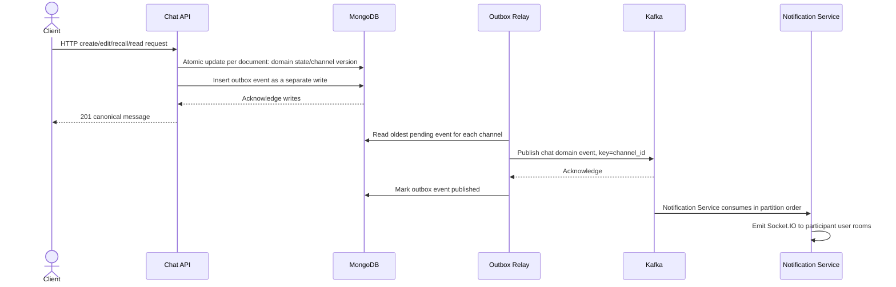

# Chat Service: Kafka Producer và Outbox với Mongo Standalone

> Trạng thái hiện tại (2026-10-10): Chat Service hỗ trợ Mongo standalone và không dùng transaction. Nội dung cũ mô tả outbox nguyên tử là mục tiêu kiến trúc trước đây, không phải bảo đảm của implementation hiện tại.

## Mục tiêu

Chat Service tiếp tục là nguồn dữ liệu chính cho channel và message. Sau khi lưu message thành công, Chat phát domain event để các service khác xử lý realtime, push, search hoặc analytics. Chat không gọi HTTP trực tiếp sang Notification Service.

Chat là nguồn dữ liệu chính của message và read cursor. Tất cả event realtime của chat được ghi vào Mongo outbox và chuyển qua Kafka tới Notification Service. Chat Service không giữ WebSocket và không emit event tới client.

## Hiện trạng trong repository

- `POST /api/v1/chat/channels/:channel-id/messages` xác thực user, kiểm tra membership và lưu message. Prefix cũ `/v1/api` vẫn được giữ tạm thời.
- Create/edit/recall/read cursor cập nhật document nghiệp vụ, sau đó ghi event vào `outbox_events` bằng các Mongo operation riêng.
- Outbox relay publish Kafka; Notification Service sở hữu Socket.IO delivery.

Standalone Mongo chỉ bảo đảm atomicity cho từng document. Nếu process dừng sau khi cập nhật message/read cursor nhưng trước khi insert outbox, dữ liệu nghiệp vụ vẫn có thể được lưu mà không có event; request cũng có thể báo lỗi dù domain write đã thành công. Nếu outbox insert hoàn tất nhưng relay dừng, event vẫn nằm trong outbox để chạy lại. Trước khi retry một request báo lỗi, client nên kiểm tra REST history. Không dùng wording “transactional outbox” để mô tả mode này.

Vì message và Kafka là hai hệ thống lưu trữ độc lập, không nên chỉ lưu Mongo rồi gọi Kafka ngay trong request: process có thể dừng ở giữa và làm mất event. Không nên gửi Kafka trước khi commit Mongo vì consumer có thể nhận event của message chưa được lưu.

## Luồng đề xuất



Chat trả response sau khi các Mongo write của request thành công. Sự cố Notification Service/Kafka không rollback dữ liệu domain. Relay thử publish tối đa ba lần tổng cộng; sau đó lưu event đã có trong outbox ở trạng thái `failed` cùng lý do để operator xem/replay. Các channel khác tiếp tục được xử lý. Vì các write domain/outbox tách rời, crash ở giữa có thể làm event bị thiếu; client cần dùng REST history để đồng bộ lại.

## MongoDB outbox

Tạo collection `outbox_events`. Record lưu event envelope cùng trạng thái relay. Bản triển khai bọc envelope trong trường `event` và lưu partition key/trạng thái bên ngoài:

```json
{
  "_id": "Mongo ObjectId",
  "event_id": "UUID ổn định",
  "event": {
    "event_id": "UUID ổn định",
    "event_type": "chat.message.created.v1",
    "schema_version": 1,
    "occurred_at": "2026-10-04T10:00:00Z",
    "producer": "chat-service",
    "aggregate_type": "channel",
    "aggregate_id": "<channel-id>",
    "aggregate_version": 42,
    "data": {}
  },
  "partition_key": "<channel-id>",
  "status": "pending",
  "attempt_count": 0,
  "next_attempt_at": "2026-10-04T10:00:00Z",
  "published_at": null,
  "last_error": null,
  "created_at": "2026-10-04T10:00:00Z"
}
```

Index tối thiểu:

- Unique index trên `event_id`.
- Index theo `(status, partition_key, event.aggregate_version)` để tìm event đầu tiên của mỗi channel.
- Một lease chung elect relay leader; leader publish tối đa 16 channel-head song song. `lease_duration` phải lớn hơn `publish_timeout`.

`event_id` được tạo một lần và lưu cùng outbox record. Nếu relay gửi Kafka thành công nhưng process dừng trước khi cập nhật `status=published`, relay có thể gửi lại cùng event. Consumer phải dedupe bằng `event_id`; không dựa vào Kafka producer để giải quyết khoảng trống giữa Kafka và MongoDB. Mongo standalone không bảo đảm domain write và outbox record cùng commit.

## Event contract

Topic đề xuất: `chat.conversation.events.v1`. Partition key là `channel_id` để giữ thứ tự event trong một channel.

```json
{
  "event_id": "<stable-id>",
  "event_type": "chat.message.created.v1",
  "schema_version": 1,
  "occurred_at": "2026-10-04T10:00:00Z",
  "producer": "chat-service",
  "aggregate_type": "channel",
  "aggregate_id": "<channel-id>",
  "aggregate_version": 55,
  "data": {
    "channel_id": "<channel-id>",
    "participant_ids": ["<sender-sub>", "<peer-sub>"],
    "message": {
      "id": "<message-id>",
      "channel_id": "<channel-id>",
      "sender_id": "<sender-sub>",
      "client_message_id": "<client-id>",
      "type": "text",
      "content": "Xin chào",
      "seq": 42,
      "revision": 1,
      "created_at": "2026-10-04T10:00:00Z",
      "updated_at": "2026-10-04T10:00:00Z"
    }
  }
}
```

Các event còn lại là `chat.message.updated.v1`, `chat.message.recalled.v1` với cùng message object, và `chat.read-cursor.advanced.v1` với `channel_id`, `participant_ids`, `user_id`, `last_read_seq`. `aggregate_version` tăng trên channel document khi write event được xử lý, bao gồm read cursor; vì outbox được ghi riêng, version có thể tăng dù event sau đó không được insert.

Với chat 1-1 hiện tại, `participant_ids` lấy từ channel đã được Chat Service xác thực. Realtime có thể gửi event tới hai user để đồng bộ các thiết bị của sender; nhánh push về sau thường chỉ gửi tới participant khác `sender_id`.

Payload có thể chứa nội dung message để Notification Service đẩy ngay. Khi đó topic phải được bảo vệ bằng ACL/TLS phù hợp và retention cần được xem xét vì Kafka sẽ chứa dữ liệu chat. Nếu không muốn message body trong Kafka, chỉ phát `message_id`/`channel_id`/`sequence`; client tải nội dung từ Chat API sau khi nhận event.

## Ghi message và outbox trên Mongo standalone

Các write hiện chạy theo thứ tự riêng:

1. Tạo/cập nhật message hoặc read cursor bằng thao tác atomic trên document tương ứng.
2. Tăng `channel.last_event_version` bằng thao tác atomic trên document channel.
3. Tạo và insert outbox event.

Mongo standalone không thể rollback các bước đã thành công nếu bước sau lỗi. Có thể để lại sequence/version gap hoặc domain state không có event nếu process dừng giữa các bước. Khi idempotency key trùng và repository trả message đã tồn tại (`created=false`), không tạo thêm message hay outbox event. Client nên dùng history API để sửa trạng thái nếu phát hiện event gap.

Chat Service không còn Hub realtime. Payload message gửi qua Socket.IO có cùng tên trường và shape với REST `MessageResponse`; envelope Socket.IO chứa `event_id`, event name, `aggregate_version` và `payload`.

## Outbox relay

Hiện relay chạy nền cùng Chat Service, dùng chung cấu hình Mongo/Kafka. Có thể tách thành process riêng sau nếu cần scale độc lập:

1. Acquire/gia hạn lease; chỉ leader được xử lý outbox.
2. Chọn pending event có `aggregate_version` nhỏ nhất trong từng channel.
3. Publish các channel-head khác nhau song song (tối đa 16) với `partition_key` làm Kafka key.
4. Chỉ sau Kafka acknowledgement mới đánh dấu `published`.
5. Retry với exponential backoff, tối đa ba lần tổng cộng. Sau lần thứ ba, đặt `status=failed`, lưu `failed_at` và `last_error`, ghi log kèm event ID/channel/version. Giữ full event trong Mongo để operator replay; event kế tiếp cùng channel vẫn có thể chạy, client phát hiện gap và tải lại trạng thái từ Chat API.

> Một relay leader vẫn là cách phối hợp/failover đơn giản; nhiều channel có thể được publish đồng thời. Event lỗi không chặn channel khác. Khi bỏ qua event lỗi sau giới hạn retry, thứ tự event còn lại trong channel vẫn tăng theo `aggregate_version`, nhưng có thể thiếu version; client phải phát hiện gap và đồng bộ lại từ Chat API.

Kafka delivery và outbox relay có thể tạo duplicate. Notification consumer và client cần idempotent. Client hiện có thể dedupe theo message ID; event ID ổn định hỗ trợ dedupe xuyên các consumer.

## Phạm vi event tiếp theo

Runtime phát `chat.message.created.v1`, `chat.message.updated.v1`, `chat.message.recalled.v1` và `chat.read-cursor.advanced.v1` khi các bước ghi tương ứng thành công. Event được insert sau domain write, không nằm trong cùng transaction.

## Vận hành và kiểm tra

- Cấu hình `KAFKA_BROKERS`, client ID, SASL/TLS và topic từ environment; không commit credential.
- Tạo topic trước khi bật producer. Production cần replication factor và retention phù hợp; topic local một partition không phải cấu hình production.
- Theo dõi số lượng/tuổi outbox pending và failed, publish lỗi/retry, Kafka producer error, consumer lag, realtime adapter health, DLQ volume và publish-to-emit latency.
- Khi Kafka down, API vẫn ghi event đã tạo vào outbox và trả response nếu các Mongo write thành công; cảnh báo nếu outbox backlog quá lâu. Nếu gặp lỗi giữa domain write và outbox insert, cần kiểm tra log và đồng bộ bằng REST history.
- Operator tìm record `status: "failed"` trong `outbox_events`, kiểm tra `event_id`, `partition_key`, `aggregate_version`, `last_error` và payload, rồi quyết định replay hay xử lý thủ công. Replay event cũ có thể bị client bỏ qua nếu đã đi qua version đó; sau đó client nên đồng bộ REST history.
- Client dedupe bằng `event_id`, áp dụng thứ tự `aggregate_version` trong channel, bỏ revision cũ và gọi Chat API khi phát hiện gap.
